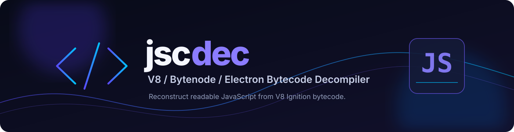

<div align="center">
  
  <br>

  <p><strong>Pure-JavaScript decompiler for Bytenode / V8 <code>SerializedCodeData</code> (<code>.jsc</code>) files.</strong></p>
  <p>Reconstruct readable JavaScript from V8 Ignition bytecode snapshots — without a custom C++ V8 build.</p>

  <p>
    <a href="https://jsc-decompiler.vercel.app"><strong>🌐 Try the Web Decompiler</strong></a>
    ·
    <a href="https://github.com/8zav/jscdec"><strong>⭐ View on GitHub</strong></a>
  </p>

  <p>
    =18">
    
    
    <a href="https://github.com/8zav/jscdec/stargazers"></a>
    <a href="https://github.com/8zav/jscdec/network/members"></a>
  </p>
</div>

---

## 🌐 Web Decompiler

**No installation required.** Open the web app, drop a `.jsc` file into the browser, and decompile it.

**[https://jsc-decompiler.vercel.app](https://jsc-decompiler.vercel.app)**


https://github.com/user-attachments/assets/98a98f6a-83f6-49f1-8a08-1fe047629554


The web version runs client-side; according to the project, files are not uploaded to a server.

## Contents

- [Features](#-features)
- [Supported Versions](#-supported-versions)
- [Installation](#-installation)
- [Usage](#-usage)
- [Example Output](#-example-output)
- [Post-Processing](#-post-processing--ai-code-cleanup)
- [Project Structure](#-project-structure)
- [Security and Runtime Verification](#-security-and-runtime-verification)

## ✨ Features

### Runtime and heap support

- **No native build dependencies** — runs on standard Node.js (`>= 18`).
- **Dual heap architecture support:**
  - 4-byte pointer-compressed V8 snapshots (Electron 30–33 / V8 12.4–12.8).
  - 8-byte uncompressed x64 V8 snapshots (Node.js 20–22 / V8 11.3–12.x and Electron utility workers).

### AST and control-flow reconstruction

- CommonJS module wrapper unwrapping: `require`, `module.exports`, `exports`, `__dirname`, and `__filename`.
- Original declaration ordering through V8 `SourcePositionTable` decoding.
- Classes, inheritance (`extends` / `super`), static and instance methods, getters, and setters.
- `async` / `await`, including generator state-machine stripping.
- `try` / `catch` / `finally`.
- Structured `for`, `for...of`, `for...in`, `while`, and `switch` statements.
- Short-circuit logic (`&&`, `||`, `??`), ternaries, optional chaining, template literals, destructuring, and default parameters.

### Semantic recovery

- Recovers function names, class and method names, closure context variables (`ScopeInfo`), and property keys.
- Infers local and parameter names from call targets and usage context.

### Read-Only Space Oracle

Resolves V8 internal Read-Only (`RO_SPACE`) and Root table string/symbol references dynamically using the target Electron/Node binary (`--runtime`) or built-in snapshot tables.

## 🧩 Supported Versions

| Runtime / Target | V8 Version | Pointer Size | Status |
| :--- | :--- | :--- | :--- |
| **Electron 32.x** *(primary target)* | **V8 12.8** | 4-byte (pointer compression) | **Full support** — 195 Ignition opcodes + Oracle |
| **Electron 30.x–33.x** | **V8 12.4–12.8** | 4-byte (pointer compression) | Supported via `--runtime <electron.exe>` and `tools/gen-opcodes.js` |
| **Node.js 20.x–22.x (x64)** | **V8 11.3–12.x** | 8-byte (uncompressed x64) | Supported |

> **Other V8 versions:** Node 18, Electron 17–29, and Electron 34+ may require regenerating the opcode table for the target runtime. The deserializer (`src/heap.js`), object model (`src/model.js`), and opcode table (`src/opcodes.js`) are modular. Run `node tools/gen-opcodes.js` against the target runtime binary when opcode numbering differs.

## 📦 Installation

Clone the repository:

```bash
git clone https://github.com/8zav/jscdec.git
cd jscdec
```

The project runs on Node.js `>= 18`. No custom C++ V8 build, `depot_tools`, or `ninja` is required.

## 🚀 Usage

### 1. Decompile one `.jsc` file

Print the result to the terminal:

```bash
node bin/jscdec.js path/to/file.jsc
```

Save the decompiled source to a file:

```bash
node bin/jscdec.js path/to/file.jsc -o output.js
```

### 2. Decompile a directory

```bash
node bin/jscdec.js path/to/build-stage -o out/
```

### 3. Resolve runtime-specific `RO_SPACE` constants

`jscdec` includes a pre-built V8 12.8 Read-Only heap table (`templates/ro-v12.8.json`), allowing many Electron 32 `.jsc` files to be decompiled without an external binary.

If custom or unindexed `RO_SPACE` constants are encountered, runtime discovery follows this order:

1. Explicit `--runtime <path/to/electron.exe>` argument or the `JSC_RUNTIME` environment variable.
2. `bin/electron.exe` or `tools/electron.exe` inside the repository.
3. Auto-discovery from the target `.jsc` directory, walking parent folders for `node_modules/electron/dist/electron.exe` or a packaged Electron executable beside `icudtl.dat` / `chrome_100_percent.pak`.
4. Local `node_modules/electron/dist/electron.exe`, if Electron 32 is installed.

Example:

```bash
node bin/jscdec.js path/to/build-stage -o out/ --runtime "path/to/electron.exe"
```

## 🧪 Example Output

Example of the kind of readable JavaScript structure the decompiler can reconstruct:

```js
const os = require("os");
const fs = require("fs");
const path = require("path");
const axios = require("axios");
const { machineIdSync } = require("node-machine-id");
const { app, BrowserWindow, ipcMain } = require("electron");

function licenseFilePath() {
  return path.join(app.getPath("userData"), "license.json");
}

async function callAuth(backendUrl, key, hwid, isHeartbeat = false) {
  try {
    return (await axios.post(`${backendUrl}/api/auth`, {
      licenseKey: key,
      hwid,
      hostname: os.hostname(),
      heartbeat: isHeartbeat
    }, {
      timeout: 10000
    })).data;
  } catch (err) {
    if (err.response && err.response.data) {
      return err.response.data;
    }
    return {
      ok: false,
      reason: "network_error"
    };
  }
}
```

## 🧹 Post-Processing & AI Code Cleanup

V8 compilation discards comments, formatting, and local stack variable names that are not captured (unless they are retained through closures or stored as object/module properties).

`jscdec` reports automatic recovery of approximately 90% of local and parameter names through heuristic type/call inference. Complex functions or obfuscated files (for example, string-array obfuscators using `_0x...` identifiers) may still contain generic register names such as `v0`, `v1`, or `a0`.

For a more readable result, you can pass the generated `.js` file to an LLM and ask it to improve names and formatting **without changing runtime behavior**. This is an optional post-processing step, not part of the decompiler itself.

## 🔐 Security and Runtime Verification

The original project documentation states that an official, unmodified **Electron 32** executable is bundled at `tools/electron.exe` through Git LFS.

- **File:** `tools/electron.exe`
- **SHA-256:** `217C7ABC77AAA868B9423FF3E6E8F40F62633CCC4121786FAC64E481AEF3429D`

Verify the file locally in PowerShell:

```powershell
Get-FileHash tools\electron.exe -Algorithm SHA256
```

If you do not want to use the bundled executable, you can:

1. Allow `jscdec` to detect the target application's Electron executable.
2. Provide your own binary with `--runtime "path/to/electron.exe"`.
3. Install Electron 32 with `npm i -D electron@32`.

## 📁 Project Structure

```text
├── bin/
│   └── jscdec.js            # CLI entry point (single file or batch directory)
├── src/
│   ├── heap.js              # V8 SerializedCodeData deserializer (4-byte & 8-byte snapshots)
│   ├── model.js             # Heap object decoder (SharedFunctionInfo, ScopeInfo, BytecodeArray)
│   ├── oracle.js            # Dynamic Electron/Node RO_SPACE & Root table string resolver
│   ├── program.js           # Constant pool, ScopeInfo & SourcePositionTable decoder
│   ├── opcodes.js           # V8 12.8 Ignition bytecode opcode definitions (195 opcodes)
│   ├── disasm.js            # Ignition bytecode disassembler (Wide / ExtraWide / Jump targets)
│   ├── decompile.js         # Symbolic execution engine & function/class builder
│   ├── decompile-ops.js     # Per-opcode symbolic state & accumulator transitions
│   ├── decompile-flow.js   # CFG structuring (loops, switch, try/catch/finally, ternary, &&/||)
│   ├── post.js              # AST optimization, destructuring, loop shaping & variable renaming
│   ├── ast.js               # JavaScript AST pretty-printer
│   └── index.js             # Public API (decompileFile)
├── templates/
│   └── oracle-v12.8.jsc     # Template code cache for live RO_SPACE oracle resolution
└── tools/
    ├── electron.exe         # Bundled Electron 32 runtime for RO_SPACE oracle
    ├── dump.js              # Disassembly & heap inspection utility
    └── gen-opcodes.js       # Opcode table generator for other V8 builds
```

---

<div align="center">
  <p><strong>jscdec</strong> · V8 / Bytenode / Electron bytecode decompiler</p>
  <p><a href="https://jsc-decompiler.vercel.app">Try the web decompiler</a> · <a href="https://github.com/8zav/jscdec">GitHub repository</a></p>
</div>
